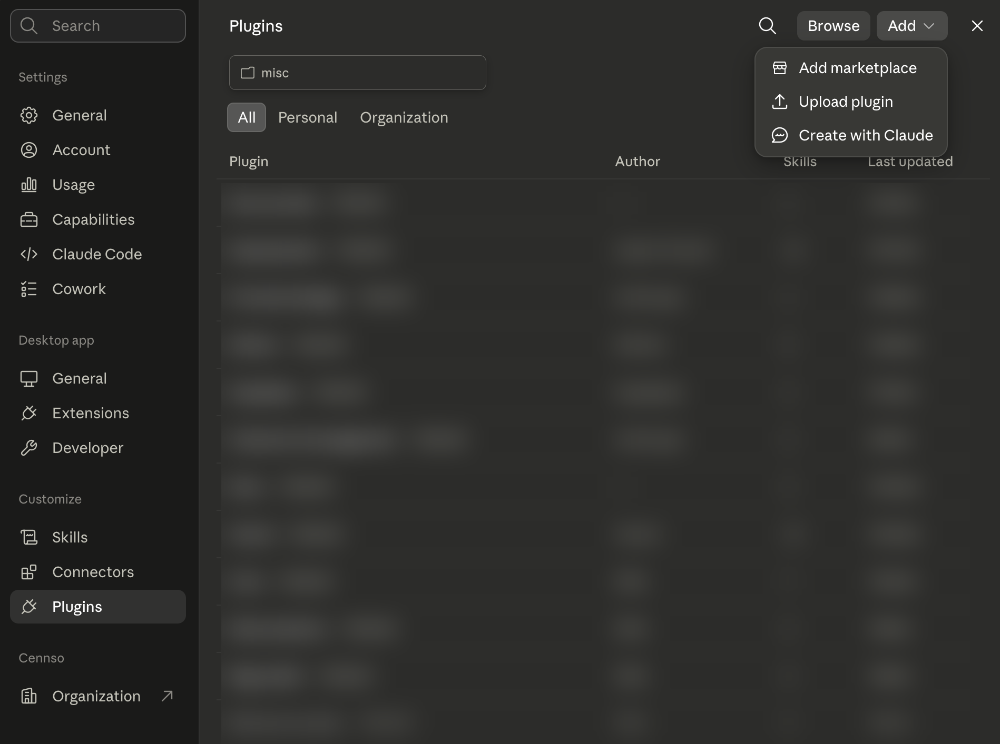
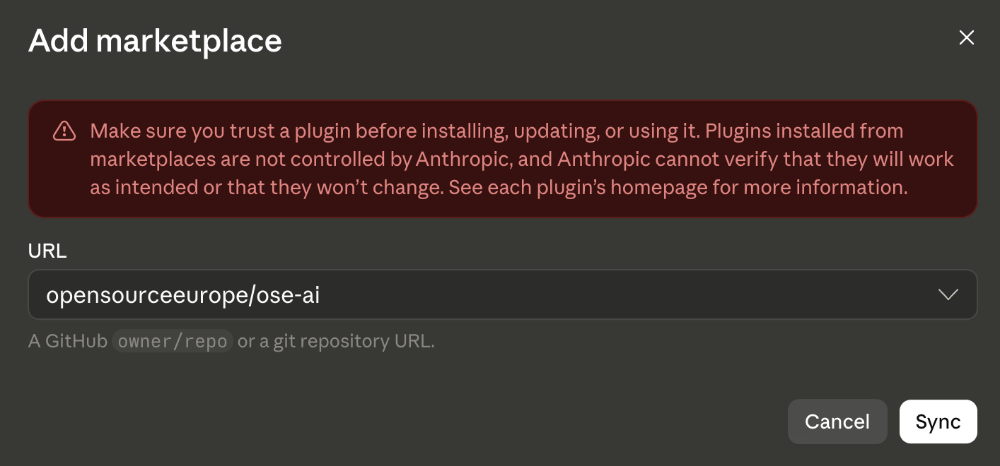
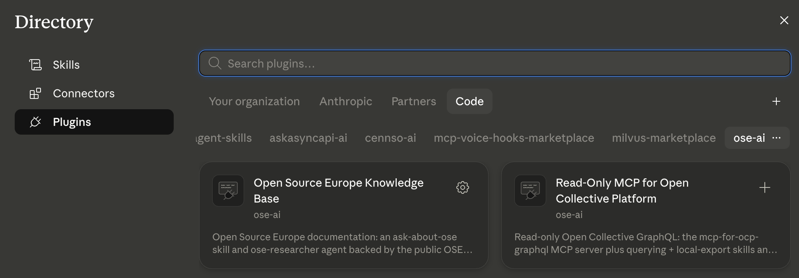

# ose-ai

The [Open Source Europe](https://github.com/opensourceeurope) Claude Code plugin marketplace — a single catalog listing the OSE plugins. Each plugin's code lives in its own repository; this repo just points at them.

## Contents

- [Plugins](#plugins)
- [Install](#install)
  - [In the Claude Desktop app (no terminal)](#in-the-claude-desktop-app-no-terminal)
  - [In the Claude Code CLI](#in-the-claude-code-cli)
  - [In OpenAI Codex](#in-openai-codex)
- [How it's wired](#how-its-wired)
- [AI use](#ai-use)
- [License](#license)

## Plugins

| Plugin | What it does | Source |
|---|---|---|
| `ose-knowledge` | An `ose-researcher` agent backed by the public OSE docs MCP server. | [opensourceeurope.org](https://github.com/opensourceeurope/opensourceeurope.org) |
| `oc-platform-mcp` | Read-only Open Collective GraphQL: the `mcp-for-ocp-graphql` MCP server plus querying + local-export skills and an analyst agent. | [mcp-for-ocp-graphql](https://github.com/opensourceeurope/mcp-for-ocp-graphql) |

## Install

### In the Claude Desktop app (no terminal)

1. Open **Settings** and select **Plugins** (under *Customize* in the left sidebar).
2. In the top right, click **Add ▾**, then **Add marketplace**.

   


3. In the **URL** field, paste the marketplace reference below and click **Sync**:

   ```
   opensourceeurope/ose-ai
   ```

   There is no file to download and no installer — the "installation reference" is simply this GitHub `owner/repo`. (A full `https://github.com/opensourceeurope/ose-ai` URL works too.)

   


4. The **Directory** opens on the **ose-ai** tab showing two plugins. Open either card and install it, choosing whether to enable it for **all projects** or a **specific project**:
   - **Open Source Europe Knowledge Base** — the `ose-knowledge` plugin
   - **Read-Only MCP for Open Collective Platform** — the `oc-platform-mcp` plugin

   


After installing, a full restart of the app (or a new chat) loads the plugin's skills, agents, and MCP servers.

### In the Claude Code CLI

```
/plugin marketplace add opensourceeurope/ose-ai
/plugin install ose-knowledge@ose-ai
/plugin install oc-platform-mcp@ose-ai
```

Pull in newer plugin versions with `/plugin marketplace update ose-ai`, or enable auto-update for the marketplace so it refreshes in the background.

### In OpenAI Codex

Codex reads a separate catalog, `.agents/plugins/marketplace.json`. It lists `oc-platform-mcp` only, because `ose-knowledge` has no Codex manifest yet.

```bash
codex plugin marketplace add opensourceeurope/ose-ai
```

Then run `/plugins` in Codex, install `oc-platform-mcp`, and start a new session to load it.

## How it's wired

This repo holds only the catalogs: `.claude-plugin/marketplace.json` for Claude and `.agents/plugins/marketplace.json` for Codex. Each entry uses a `git-subdir` source that points at the plugin's own repo and subdirectory, so plugin code, issues, and releases stay where they belong. Plugin versions come from each plugin's own `plugin.json` — never duplicated here.

## AI use

Contributions to this repo may be AI-assisted under the OSE [AI Policy](https://github.com/opensourceeurope/.github/blob/main/AI-POLICY.md). See [AGENTS.md](AGENTS.md) for the rules agents must follow.

## License

[MIT](LICENSE) © Open Source Europe.
